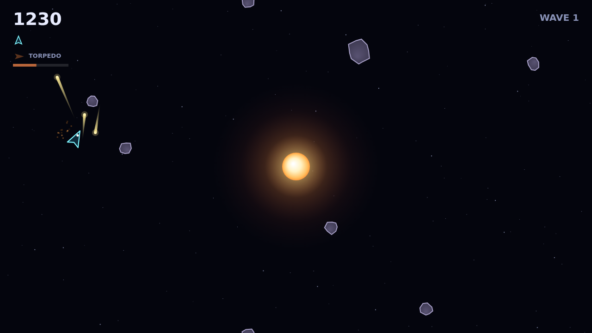

# Shatter

Shatter is a rock shooter built around a star. It burns at the centre of a
wrapping field of deep space, and its gravity pulls on every bullet you fire and
every rock drifting around you, but never on your ship. You fly on pure momentum,
turning and thrusting, while the well bends the whole board around the light.

Each wave fills the field with Large rocks, and the big ones are armored: they
crack and glow under each hit before a Large finally splits into two Mediums,
and each of those into two Smalls. Clear the last fragment and a denser, faster
wave rolls in. Feed a rock to the star and it is not destroyed. It comes tumbling
back in from the edge of the field, so the only way through a wave is to shoot it
down.

The well is what makes it sing. Shots curve as they cross the centre, so you can
wrap a bullet around the star to hit a rock hiding on its far side, and the rocks
themselves swing past on curved, slingshotting paths. The core is solid, so you
can graze along its surface and slide free, but the rocks it flings at you are
not.

When a rock will not break in time, you have the torpedo: one guided shot on a
ten-second recharge that locks onto whatever lies in a narrow cone ahead, flies
straight through the gravity, and destroys any rock outright. And every so often
a saucer drifts in to hunt you, weaving across the field and firing at your ship.
Shoot it down for a big bonus, and reach every ten thousand points to earn an
extra ship.
